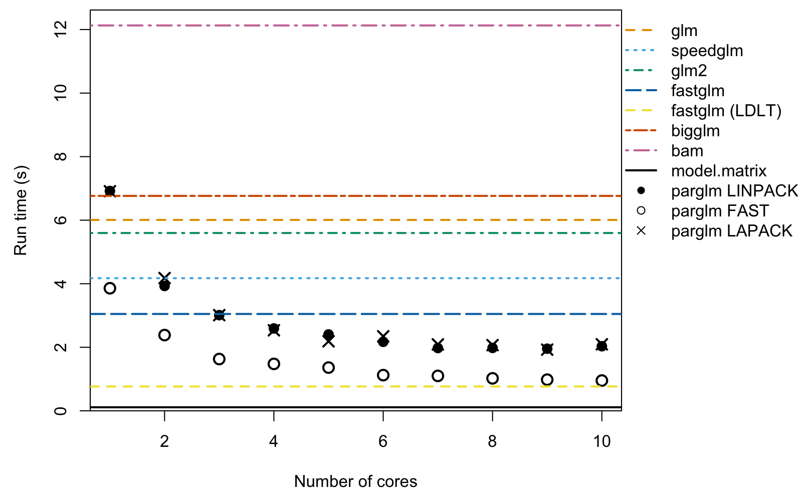
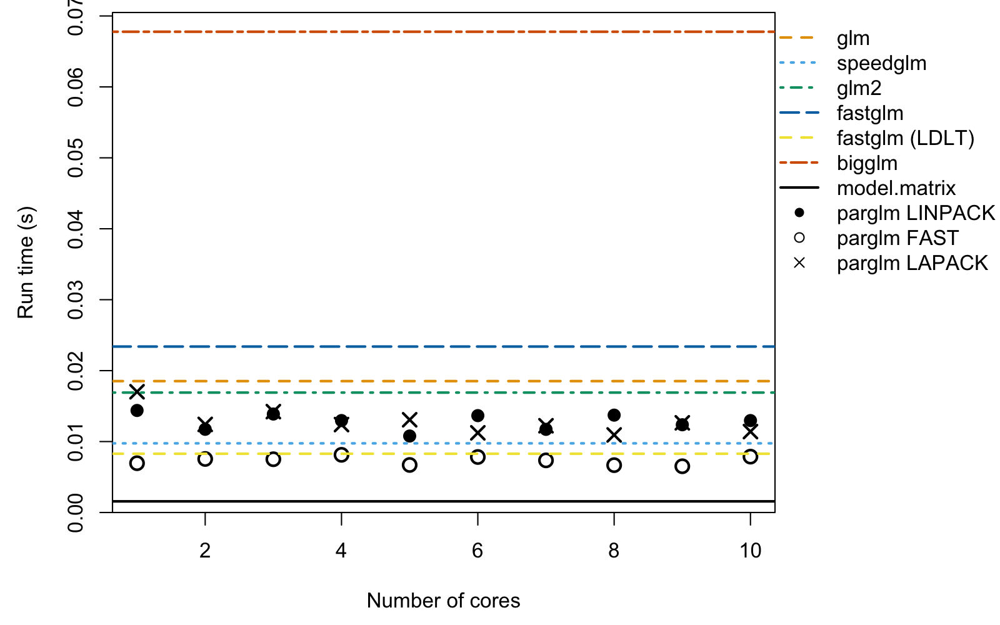

The motivation for the `parglm` package is a parallel version of the `glm`
function. It solves the iteratively re-weighted least squares using a QR
decomposition with column pivoting with the `DGEQP3` function from LAPACK.
The computation is done in parallel as in the `bam` function in the `mgcv` package. The
cost is an additional $O(Mp^2 + p^3)$ where $p$ is the number of
coefficients and $M$ is the number of chunks to be computed in parallel.
The advantage is that you do not need to compile the package with
an optimized BLAS or LAPACK which supports multithreading. The package also
includes a method that computes the Fisher information and then solves the normal
equation as in the `speedglm` package. This is faster but less numerically
stable.

## Example of computation time


Below, we estimate a logistic regression with 1000000 observations
and 50 covariates. We vary the number of cores being used with the
`nthreads` argument to `parglm.control`. The `method` argument sets which
method is used. `LINPACK` uses the same pivoted QR (`dqrdc2`) as `glm.fit`
for the final decomposition; `LAPACK` uses `DGEQP3` from LAPACK throughout;
and `FAST` solves the normal equations from the Fisher information, similar
to the `speedglm` package.


``` r
#####
# simulate
n # number of observations
#> [1] 1000000
p # number of covariates
#> [1] 50
set.seed(68024947)
X <- matrix(rnorm(n * p, 1/p, 1/sqrt(p)), n, ncol = p)
df <- data.frame(y = 1/(1 + exp(-(rowSums(X) - 1))) > runif(n), X)
```


``` r
#####
# compute and measure time. Setup call to make
library(microbenchmark)
library(speedglm)
library(fastglm)
library(glm2)
library(biglm)
library(mgcv)
library(parglm)
X_mat <- model.matrix(y ~ ., df)
biglm_form <- reformulate(names(df)[-1], response = "y")
bam_form   <- biglm_form
cl <- list(
  quote(microbenchmark),
  glm      = quote(glm     (y ~ ., binomial(), df)),
  speedglm = quote(speedglm(y ~ ., family = binomial(), data = df)),
  glm2     = quote(glm2    (y ~ ., binomial(), df)),
  fastglm  = quote(fastglm (X_mat, as.numeric(df$y), family = binomial())),
  fastglm3 = quote(fastglm (X_mat, as.numeric(df$y), family = binomial(), method = 3L)),
  bigglm   = quote(bigglm  (biglm_form, df, family = binomial())),
  bam      = quote(bam     (bam_form, family = binomial(), data = df)),
  times = 11L)
tfunc <- function(method = "LINPACK", nthreads)
  parglm(y ~ ., binomial(), df, control = parglm.control(method = method,
                                                         nthreads = nthreads))
cl <- c(
  cl, lapply(1:n_threads, function(i) bquote(tfunc(nthreads = .(i)))))
names(cl)[10:(10L + n_threads - 1L)] <- paste0("parglm-LINPACK-", 1:n_threads)

cl <- c(
  cl, lapply(1:n_threads, function(i) bquote(tfunc(
    nthreads = .(i), method = "FAST"))))
names(cl)[(10L + n_threads):(10L + 2L * n_threads - 1L)] <-
  paste0("parglm-FAST-", 1:n_threads)

cl <- c(
  cl, lapply(1:n_threads, function(i) bquote(tfunc(
    nthreads = .(i), method = "LAPACK"))))
names(cl)[(10L + 2L * n_threads):(10L + 3L * n_threads - 1L)] <-
  paste0("parglm-LAPACK-", 1:n_threads)

cl <- as.call(cl)
cl # the call we make
#> microbenchmark(glm = glm(y ~ ., binomial(), df), speedglm = speedglm(y ~ 
#>     ., family = binomial(), data = df), glm2 = glm2(y ~ ., binomial(), 
#>     df), fastglm = fastglm(X_mat, as.numeric(df$y), family = binomial()), 
#>     fastglm3 = fastglm(X_mat, as.numeric(df$y), family = binomial(), 
#>         method = 3L), bigglm = bigglm(biglm_form, df, family = binomial()), 
#>     bam = bam(bam_form, family = binomial(), data = df), times = 11L, 
#>     `parglm-LINPACK-1` = tfunc(nthreads = 1L), `parglm-LINPACK-2` = tfunc(nthreads = 2L), 
#>     `parglm-LINPACK-3` = tfunc(nthreads = 3L), `parglm-LINPACK-4` = tfunc(nthreads = 4L), 
#>     `parglm-LINPACK-5` = tfunc(nthreads = 5L), `parglm-LINPACK-6` = tfunc(nthreads = 6L), 
#>     `parglm-LINPACK-7` = tfunc(nthreads = 7L), `parglm-LINPACK-8` = tfunc(nthreads = 8L), 
#>     `parglm-LINPACK-9` = tfunc(nthreads = 9L), `parglm-LINPACK-10` = tfunc(nthreads = 10L), 
#>     `parglm-FAST-1` = tfunc(nthreads = 1L, method = "FAST"), 
#>     `parglm-FAST-2` = tfunc(nthreads = 2L, method = "FAST"), 
#>     `parglm-FAST-3` = tfunc(nthreads = 3L, method = "FAST"), 
#>     `parglm-FAST-4` = tfunc(nthreads = 4L, method = "FAST"), 
#>     `parglm-FAST-5` = tfunc(nthreads = 5L, method = "FAST"), 
#>     `parglm-FAST-6` = tfunc(nthreads = 6L, method = "FAST"), 
#>     `parglm-FAST-7` = tfunc(nthreads = 7L, method = "FAST"), 
#>     `parglm-FAST-8` = tfunc(nthreads = 8L, method = "FAST"), 
#>     `parglm-FAST-9` = tfunc(nthreads = 9L, method = "FAST"), 
#>     `parglm-FAST-10` = tfunc(nthreads = 10L, method = "FAST"), 
#>     `parglm-LAPACK-1` = tfunc(nthreads = 1L, method = "LAPACK"), 
#>     `parglm-LAPACK-2` = tfunc(nthreads = 2L, method = "LAPACK"), 
#>     `parglm-LAPACK-3` = tfunc(nthreads = 3L, method = "LAPACK"), 
#>     `parglm-LAPACK-4` = tfunc(nthreads = 4L, method = "LAPACK"), 
#>     `parglm-LAPACK-5` = tfunc(nthreads = 5L, method = "LAPACK"), 
#>     `parglm-LAPACK-6` = tfunc(nthreads = 6L, method = "LAPACK"), 
#>     `parglm-LAPACK-7` = tfunc(nthreads = 7L, method = "LAPACK"), 
#>     `parglm-LAPACK-8` = tfunc(nthreads = 8L, method = "LAPACK"), 
#>     `parglm-LAPACK-9` = tfunc(nthreads = 9L, method = "LAPACK"), 
#>     `parglm-LAPACK-10` = tfunc(nthreads = 10L, method = "LAPACK"))

out <- eval(cl)
#> Warning in microbenchmark(glm = glm(y ~ ., binomial(), df), speedglm =
#> speedglm(y ~ : less accurate nanosecond times to avoid potential integer
#> overflows
```


``` r
s <- summary(out, include_cld = FALSE) # result from `microbenchmark`
print(s[, c("expr", "min", "mean", "median", "max")], digits  = 3,
      row.names	= FALSE)
#>               expr  min mean median   max
#>                glm 2415 3668   3618  7638
#>           speedglm  767  938    915  1207
#>               glm2 2493 3389   2731  6823
#>            fastglm 2611 3562   2692  8560
#>           fastglm3  667  747    702   966
#>             bigglm 6157 8514   7908 13458
#>                bam 4559 5525   4745  7766
#>   parglm-LINPACK-1 1850 2278   1940  3731
#>   parglm-LINPACK-2 1593 1967   1806  2558
#>   parglm-LINPACK-3 1474 2019   2070  2653
#>   parglm-LINPACK-4 1477 1664   1600  2024
#>   parglm-LINPACK-5 1439 1860   1543  2749
#>   parglm-LINPACK-6 1486 1760   1601  2216
#>   parglm-LINPACK-7 1444 1708   1572  2572
#>   parglm-LINPACK-8 1397 1884   1592  2720
#>   parglm-LINPACK-9 1448 1851   1661  3380
#>  parglm-LINPACK-10 1432 1663   1649  1976
#>      parglm-FAST-1  455  656    632   891
#>      parglm-FAST-2  439  645    597  1445
#>      parglm-FAST-3  375  508    519   639
#>      parglm-FAST-4  397  590    490  1174
#>      parglm-FAST-5  400  573    444  1344
#>      parglm-FAST-6  354  455    462   508
#>      parglm-FAST-7  395  558    498  1159
#>      parglm-FAST-8  382  530    463  1316
#>      parglm-FAST-9  394  643    626  1399
#>     parglm-FAST-10  369  436    390   669
#>    parglm-LAPACK-1 1891 2792   2058  5016
#>    parglm-LAPACK-2 1585 1766   1678  2215
#>    parglm-LAPACK-3 1499 1755   1596  2337
#>    parglm-LAPACK-4 1537 1894   1685  3098
#>    parglm-LAPACK-5 1488 1878   1891  2751
#>    parglm-LAPACK-6 1513 1897   1922  2670
#>    parglm-LAPACK-7 1399 1899   1632  2809
#>    parglm-LAPACK-8 1420 1672   1707  1931
#>    parglm-LAPACK-9 1394 1693   1491  2607
#>   parglm-LAPACK-10 1456 1707   1651  2288
```

The plot below shows median run times versus the number of cores. Coloured
horizontal lines show the single-threaded reference times for `glm`, `speedglm`,
`glm2`, `fastglm`, `bigglm`, and `bam`. We could have used `glm.fit` and
`parglm.fit`. This would make the relative difference bigger as both call, e.g.,
`model.matrix` and `model.frame` which do take some time. To show this point, we
first compute how much time this takes and then we make the plot. The black solid
line is the computation time of `model.matrix` and `model.frame`.


``` r
modmat_time <- microbenchmark(
  modmat_time = {
    mf <- model.frame(y ~ ., df); model.matrix(terms(mf), mf)
  }, times = 10)
modmat_time # time taken by `model.matrix` and `model.frame`
#> Unit: milliseconds
#>         expr        min         lq        mean     median         uq        max
#>  modmat_time 132.840328 139.814223 261.7185472 211.423388 377.732754 446.758304
#>  neval
#>     10
```


``` r
par(mar = c(4.5, 4.5, .5, 9))
o <- aggregate(time ~ expr, out, median)[, 2] / 10^9
ylim <- range(o, 0); ylim[2] <- ylim[2] + .04 * diff(ylim)

o_linpack <- o[8L:(n_threads + 7L)]
o_fast    <- o[(n_threads + 8L):(2L * n_threads + 7L)]
o_lapack  <- o[(2L * n_threads + 8L):(3L * n_threads + 7L)]

ref_cols <- c("#E69F00", "#56B4E9", "#009E73", "#0072B2", "#F0E442", "#D55E00", "#CC79A7")
ref_lty  <- c("dashed", "dotted", "dotdash", "longdash", "44", "twodash", "1373")

plot(1:n_threads, o_linpack, xlab = "Number of cores", yaxs = "i",
     ylim = ylim, ylab = "Run time (s)", pch = 16, cex = 1.4)
points(1:n_threads, o_fast,   pch = 1, cex = 1.4, lwd = 2)
points(1:n_threads, o_lapack, pch = 4, cex = 1.4, lwd = 2)
for (i in 1:7)
  abline(h = o[i], lty = ref_lty[i], col = ref_cols[i], lwd = 2)
abline(h = median(modmat_time$time) / 10^9, lty = "solid", col = "black",
       lwd = 2)
usr <- par("usr")
par(xpd = TRUE)
legend(x = usr[2], y = usr[4], xjust = 0, yjust = 1,
       legend = c("glm", "speedglm", "glm2", "fastglm", "fastglm (LDLT)",
                  "bigglm", "bam", "model.matrix", "parglm LINPACK",
                  "parglm FAST", "parglm LAPACK"),
       lty = c(ref_lty, "solid", NA, NA, NA),
       lwd = c(2, 2, 2, 2, 2, 2, 2, 2, NA, NA, NA),
       col = c(ref_cols, "black", "black", "black", "black"),
       pch = c(NA, NA, NA, NA, NA, NA, NA, NA, 16, 1, 4),
       bty = "n")
```

<div class="figure" style="text-align: center">

<p class="caption">Plot of runtime versus number of cores.</p>
</div>

The open circles are the `FAST` method and the filled circles are the `LINPACK`
method. The `FAST` method, `speedglm`, `fastglm`, and `fastglm` (LDLT) all
compute the Fisher information and solve the normal equation; `fastglm` (LDLT)
uses an LDLT Cholesky decomposition (method 3) rather than the default
column-pivoted QR (method 0).
This is an advantage in terms of computation cost but may lead to unstable
solutions. You can alter the number of observations in each parallel chunk
with the `block_size` argument of `parglm.control`.

The single-threaded performance of `parglm` may be slower when there are more coefficients.
The cause seems to be the difference between the LAPACK and LINPACK implementation.
This is presumably due to the QR decomposition method and/or the `qr.qty` method.
On Windows, `parglm` does seem slower when built with `Rtools` and the reason
seems to be the `qr.qty` method in LAPACK, `dormqr`, which is slower than the
LINPACK method, `dqrsl`. Below is an illustration of the
computation times on this machine.


``` r
qr1 <- qr(X)
qr2 <- qr(X, LAPACK = TRUE)
microbenchmark::microbenchmark(
  `qr LINPACK`     = qr(X),
  `qr LAPACK`      = qr(X, LAPACK = TRUE),
  `qr.qty LINPACK` = qr.qty(qr1, df$y),
  `qr.qty LAPACK`  = qr.qty(qr2, df$y),
  times = 11)
#> Unit: milliseconds
#>            expr        min          lq        mean     median          uq
#>      qr LINPACK 666.013184 751.0353965 847.0958974 807.434484 862.1779300
#>       qr LAPACK 543.793660 580.2297450 650.2008333 608.928761 684.3300570
#>  qr.qty LINPACK  63.769760 102.4946700 275.3134345 238.463216 385.5647175
#>   qr.qty LAPACK 127.612254 133.8935360 180.4287224 152.576088 178.3356295
#>          max neval cld
#>  1358.840163    11 a  
#>   908.885007    11  b 
#>   727.307118    11   c
#>   345.316965    11   c
```

## Smaller datasets

For smaller datasets the per-call overhead of `parglm`'s thread pool can
exceed the gains from parallelism. Below we repeat the benchmark for
`n = 100,000` and `n = 10,000`, dropping `bam` since it is aimed at much
larger problems. Note the default `block_size` of `parglm.control` is
`10000`, so when `n = 10,000` the work cannot be split further across
threads and `parglm` effectively runs single-threaded regardless of
`nthreads`.


### n = 100,000


``` r
invisible(run_and_plot(n = 100000L, p = 50L, n_threads = n_threads))
#>               expr   min  mean median    max
#>                glm 214.5 248.6  229.4  308.4
#>           speedglm  76.3 126.1  100.6  296.6
#>               glm2 201.2 276.2  252.3  491.6
#>            fastglm 281.3 448.7  361.6  796.5
#>     fastglm (LDLT)  78.1  88.6   87.6  100.5
#>             bigglm 730.6 986.0  838.4 1657.7
#>   parglm-LINPACK-1 184.4 269.2  247.1  369.3
#>   parglm-LINPACK-2 167.9 196.4  189.7  272.6
#>   parglm-LINPACK-3 148.1 199.7  166.3  465.1
#>   parglm-LINPACK-4 109.4 143.3  142.7  207.6
#>   parglm-LINPACK-5  95.7 116.6  116.7  144.8
#>   parglm-LINPACK-6  87.7 119.9  116.6  189.6
#>   parglm-LINPACK-7  90.2 117.1  108.3  186.5
#>   parglm-LINPACK-8  79.3 102.6   91.4  190.5
#>   parglm-LINPACK-9  75.6 100.5   99.1  140.7
#>  parglm-LINPACK-10  81.3 103.0   92.9  182.6
#>      parglm-FAST-1  56.0  74.8   63.1  193.5
#>      parglm-FAST-2  46.2  69.7   52.5  213.5
#>      parglm-FAST-3  42.7  55.1   54.8   73.3
#>      parglm-FAST-4  40.4 101.0   54.1  323.3
#>      parglm-FAST-5  37.7  74.0   49.0  337.7
#>      parglm-FAST-6  39.6  49.8   50.2   59.3
#>      parglm-FAST-7  36.7  93.9   47.6  557.4
#>      parglm-FAST-8  44.6  64.0   52.4  135.4
#>      parglm-FAST-9  40.4  46.5   43.6   55.7
#>     parglm-FAST-10  40.3  70.1   43.3  316.3
#>    parglm-LAPACK-1 211.9 248.0  239.9  305.0
#>    parglm-LAPACK-2 171.0 201.7  199.0  242.9
#>    parglm-LAPACK-3 133.4 178.6  159.9  302.6
#>    parglm-LAPACK-4 131.9 194.9  159.4  528.9
#>    parglm-LAPACK-5  92.6 151.9  142.6  217.5
#>    parglm-LAPACK-6  92.0 142.4  109.7  416.0
#>    parglm-LAPACK-7  89.8 105.3   98.3  168.4
#>    parglm-LAPACK-8  78.4 115.9   94.7  192.6
#>    parglm-LAPACK-9  85.4 125.9  110.2  311.4
#>   parglm-LAPACK-10  76.9 110.3   97.1  263.1
```

<div class="figure" style="text-align: center">

<p class="caption">Plot of runtime versus number of cores for n = 100,000.</p>
</div>

### n = 10,000


``` r
invisible(run_and_plot(n = 10000L, p = 50L, n_threads = n_threads))
#>               expr   min  mean median   max
#>                glm 16.13 22.07  18.52 60.96
#>           speedglm  8.05  9.86   9.75 15.09
#>               glm2 16.05 18.25  16.90 22.16
#>            fastglm 22.22 23.83  23.39 25.61
#>     fastglm (LDLT)  7.97  8.65   8.28 10.08
#>             bigglm 61.69 68.00  67.78 78.61
#>   parglm-LINPACK-1 12.56 15.13  14.38 21.90
#>   parglm-LINPACK-2  9.98 11.90  11.73 14.78
#>   parglm-LINPACK-3 11.57 15.41  13.88 23.79
#>   parglm-LINPACK-4  9.03 12.76  12.96 17.79
#>   parglm-LINPACK-5  9.77 11.81  10.78 16.83
#>   parglm-LINPACK-6 10.10 13.27  13.66 17.00
#>   parglm-LINPACK-7 10.18 12.49  11.72 18.10
#>   parglm-LINPACK-8 10.34 13.24  13.73 15.56
#>   parglm-LINPACK-9  8.87 12.23  12.37 15.68
#>  parglm-LINPACK-10  9.92 13.56  12.96 20.66
#>      parglm-FAST-1  5.27  6.57   6.95  7.75
#>      parglm-FAST-2  5.00  7.88   7.55 12.55
#>      parglm-FAST-3  4.73  7.47   7.51 10.55
#>      parglm-FAST-4  6.40  8.05   8.13 10.16
#>      parglm-FAST-5  4.75  7.09   6.70  9.33
#>      parglm-FAST-6  5.30  8.14   7.83 11.40
#>      parglm-FAST-7  5.22  7.40   7.35 10.10
#>      parglm-FAST-8  4.99  6.66   6.67  8.64
#>      parglm-FAST-9  5.34  6.94   6.52 10.13
#>     parglm-FAST-10  6.24  7.81   7.88  9.01
#>    parglm-LAPACK-1 12.44 20.02  17.02 48.09
#>    parglm-LAPACK-2 10.48 13.17  12.42 16.57
#>    parglm-LAPACK-3 10.78 14.11  14.22 17.60
#>    parglm-LAPACK-4 10.69 16.27  12.40 49.43
#>    parglm-LAPACK-5  9.10 13.03  13.07 16.38
#>    parglm-LAPACK-6  9.68 12.55  11.23 16.70
#>    parglm-LAPACK-7  9.94 13.79  12.23 26.44
#>    parglm-LAPACK-8  8.10 12.03  10.93 18.06
#>    parglm-LAPACK-9  9.97 12.87  12.64 16.90
#>   parglm-LAPACK-10  8.74 11.69  11.41 16.35
```

<div class="figure" style="text-align: center">

<p class="caption">Plot of runtime versus number of cores for n = 10,000.</p>
</div>

## Varying the number of coefficients

The per-row cost of each method scales roughly with $p^2$ (computing
$X'WX$ at each IRLS iteration), while parglm's thread-pool overhead is
roughly fixed per call. The two effects compete: with small $p$ the
overhead dominates the parallel benefit, while with larger $p$ the
parallel work amortizes the overhead and parglm pulls ahead. Below we
contrast `n = 100,000, p = 5` (where the overhead wins) with
`n = 1,000,000, p = 20` (where the parallel work wins).

### n = 100,000, p = 5


``` r
invisible(run_and_plot(n = 100000L, p = 5L, n_threads = n_threads))
#>               expr  min mean median   max
#>                glm 43.3 45.2   44.5  49.7
#>           speedglm 32.2 33.9   33.1  39.5
#>               glm2 45.2 48.2   47.5  51.9
#>            fastglm 25.4 26.6   26.0  31.7
#>     fastglm (LDLT) 20.5 21.0   20.9  22.1
#>             bigglm 81.4 92.1   86.4 156.8
#>   parglm-LINPACK-1 28.7 32.2   32.5  37.1
#>   parglm-LINPACK-2 23.7 26.0   25.1  32.7
#>   parglm-LINPACK-3 22.1 24.0   23.9  27.6
#>   parglm-LINPACK-4 22.0 23.6   23.2  25.7
#>   parglm-LINPACK-5 21.6 24.4   23.8  33.3
#>   parglm-LINPACK-6 20.9 23.2   23.1  28.4
#>   parglm-LINPACK-7 21.5 24.3   23.7  29.8
#>   parglm-LINPACK-8 21.1 22.7   22.2  26.9
#>   parglm-LINPACK-9 20.6 24.4   23.7  29.6
#>  parglm-LINPACK-10 20.5 22.8   22.6  27.5
#>      parglm-FAST-1 28.9 32.1   32.8  36.0
#>      parglm-FAST-2 22.8 25.8   25.0  35.3
#>      parglm-FAST-3 21.5 24.4   23.1  28.9
#>      parglm-FAST-4 22.5 24.7   24.2  29.5
#>      parglm-FAST-5 21.0 23.9   22.9  35.4
#>      parglm-FAST-6 20.4 22.8   21.6  28.9
#>      parglm-FAST-7 20.4 23.2   22.2  30.8
#>      parglm-FAST-8 20.5 22.6   22.1  26.7
#>      parglm-FAST-9 20.2 23.8   23.0  30.1
#>     parglm-FAST-10 20.2 21.8   21.4  26.5
#>    parglm-LAPACK-1 29.9 32.9   33.2  37.0
#>    parglm-LAPACK-2 23.8 26.2   26.2  29.8
#>    parglm-LAPACK-3 22.5 25.3   24.8  28.7
#>    parglm-LAPACK-4 22.1 24.1   24.1  25.7
#>    parglm-LAPACK-5 21.6 23.6   23.1  25.7
#>    parglm-LAPACK-6 21.1 24.1   23.5  29.2
#>    parglm-LAPACK-7 21.2 29.0   22.1  97.9
#>    parglm-LAPACK-8 21.2 25.4   24.5  31.3
#>    parglm-LAPACK-9 20.7 23.5   22.6  29.2
#>   parglm-LAPACK-10 20.7 22.7   22.2  27.3
```

<div class="figure" style="text-align: center">

<p class="caption">Plot of runtime versus number of cores for n = 100,000 and p = 5.</p>
</div>

### n = 1,000,000, p = 20


``` r
invisible(run_and_plot(n = 1000000L, p = 20L, n_threads = n_threads))
#>               expr  min mean median  max
#>                glm  969 1117   1146 1297
#>           speedglm  544  671    620 1360
#>               glm2 1015 1207   1198 1585
#>            fastglm  715  903    774 1542
#>     fastglm (LDLT)  326  380    348  715
#>             bigglm 2581 2849   2874 3043
#>   parglm-LINPACK-1  601  713    695  896
#>   parglm-LINPACK-2  523  576    543  738
#>   parglm-LINPACK-3  488  682    580 1606
#>   parglm-LINPACK-4  475  600    533 1077
#>   parglm-LINPACK-5  464  522    523  602
#>   parglm-LINPACK-6  488  548    554  662
#>   parglm-LINPACK-7  454  537    538  645
#>   parglm-LINPACK-8  445  524    502  679
#>   parglm-LINPACK-9  444  496    466  724
#>  parglm-LINPACK-10  435  498    488  571
#>      parglm-FAST-1  384  479    442  955
#>      parglm-FAST-2  329  384    375  482
#>      parglm-FAST-3  292  340    338  408
#>      parglm-FAST-4  289  344    333  464
#>      parglm-FAST-5  287  333    322  413
#>      parglm-FAST-6  323  372    346  475
#>      parglm-FAST-7  280  347    315  540
#>      parglm-FAST-8  271  307    306  350
#>      parglm-FAST-9  276  309    292  424
#>     parglm-FAST-10  276  368    314  861
#>    parglm-LAPACK-1  592  742    732  933
#>    parglm-LAPACK-2  541  619    630  734
#>    parglm-LAPACK-3  506  588    595  665
#>    parglm-LAPACK-4  478  560    565  657
#>    parglm-LAPACK-5  482  603    556 1284
#>    parglm-LAPACK-6  457  522    512  596
#>    parglm-LAPACK-7  449  507    516  637
#>    parglm-LAPACK-8  440  494    483  570
#>    parglm-LAPACK-9  449  536    535  748
#>   parglm-LAPACK-10  432  476    475  536
```

<div class="figure" style="text-align: center">

<p class="caption">Plot of runtime versus number of cores for n = 1,000,000 and p = 20.</p>
</div>

## Session info


``` r
sessionInfo()
#> R version 4.6.2 (2026-10-29)
#> Platform: aarch64-apple-darwin23
#> Running under: macOS Golden Gate 27.2.1
#> 
#> Matrix products: default
#> BLAS:   /System/Library/Frameworks/Accelerate.framework/Versions/A/Frameworks/vecLib.framework/Versions/A/libBLAS.dylib 
#> LAPACK: /Library/Frameworks/R.framework/Versions/4.6/Resources/lib/libRlapack.dylib;  LAPACK version 3.12.1
#> 
#> locale:
#> [1] C.UTF-8/C.UTF-8/C.UTF-8/C/C.UTF-8/C.UTF-8
#> 
#> time zone: Europe/London
#> tzcode source: internal
#> 
#> attached base packages:
#> [1] stats     graphics  grDevices utils     datasets  methods   base     
#> 
#> other attached packages:
#>  [1] parglm_0.2.1         mgcv_1.9-5           nlme_3.1-172        
#>  [4] glm2_1.2.1           fastglm_0.1.4        speedglm_0.3-5      
#>  [7] biglm_0.9-3          DBI_1.3.0            MASS_7.3-66         
#> [10] Matrix_1.7-6         microbenchmark_1.5.0
#> 
#> loaded via a namespace (and not attached):
#>  [1] cli_3.6.6           knitr_1.52          TH.data_1.1-5      
#>  [4] rlang_1.3.0         xfun_0.62           otel_0.3.0         
#>  [7] zoo_1.9-1           bigmemory_4.6.6     grid_4.6.2         
#> [10] evaluate_1.0.5      mvtnorm_1.4-2       bigmemory.sri_0.1.8
#> [13] multcomp_1.4-32     compiler_4.6.2      codetools_0.2-20   
#> [16] sandwich_3.1-3      Rcpp_1.1.2          lattice_0.23-1     
#> [19] digest_0.6.39       parallel_4.6.2      splines_4.6.2      
#> [22] uuid_1.2-2          tools_4.6.2         survival_3.8-12
```
