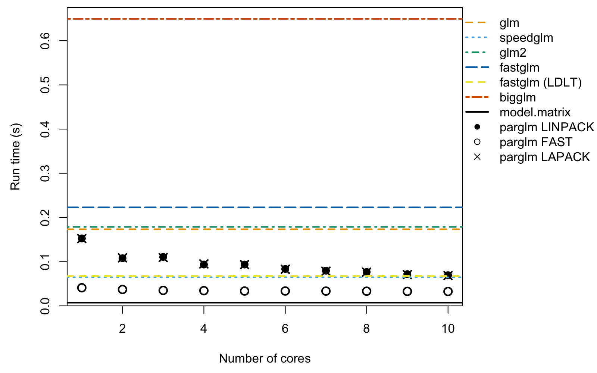

The motivation for the `parglm` package is a parallel version of the `glm`
function. It solves the iteratively re-weighted least squares using a QR
decomposition with column pivoting with the `DGEQP3` function from LAPACK.
The computation is done in parallel as in the `bam` function in the `mgcv` package. The
cost is an additional $O(Mp^2 + p^3)$ where $p$ is the number of
coefficients and $M$ is the number of chunks to be computed in parallel.
The advantage is that you do not need to compile the package with
an optimized BLAS or LAPACK which supports multithreading. The package also
includes a method that computes the Fisher information and then solves the normal
equation as in the `speedglm` package. This is faster but less numerically
stable.

## Example of computation time


Below, we estimate a logistic regression with 1000000 observations
and 50 covariates. We vary the number of cores being used with the
`nthreads` argument to `parglm.control`. The `method` argument sets which
method is used. `LINPACK` uses the same pivoted QR (`dqrdc2`) as `glm.fit`
for the final decomposition; `LAPACK` uses `DGEQP3` from LAPACK throughout;
and `FAST` solves the normal equations from the Fisher information, similar
to the `speedglm` package.


``` r
#####
# simulate
n # number of observations
#> [1] 1000000
p # number of covariates
#> [1] 50
set.seed(68024947)
X <- matrix(rnorm(n * p, 1/p, 1/sqrt(p)), n, ncol = p)
df <- data.frame(y = 1/(1 + exp(-(rowSums(X) - 1))) > runif(n), X)
```


``` r
#####
# compute and measure time. Setup call to make
library(microbenchmark)
library(speedglm)
library(fastglm)
library(glm2)
library(biglm)
library(mgcv)
library(parglm)
X_mat <- model.matrix(y ~ ., df)
biglm_form <- reformulate(names(df)[-1], response = "y")
bam_form   <- biglm_form
cl <- list(
  quote(microbenchmark),
  glm      = quote(glm     (y ~ ., binomial(), df)),
  speedglm = quote(speedglm(y ~ ., family = binomial(), data = df)),
  glm2     = quote(glm2    (y ~ ., binomial(), df)),
  fastglm  = quote(fastglm (X_mat, as.numeric(df$y), family = binomial())),
  fastglm3 = quote(fastglm (X_mat, as.numeric(df$y), family = binomial(), method = 3L)),
  bigglm   = quote(bigglm  (biglm_form, df, family = binomial())),
  bam      = quote(bam     (bam_form, family = binomial(), data = df)),
  times = 11L)
tfunc <- function(method = "LINPACK", nthreads)
  parglm(y ~ ., binomial(), df, control = parglm.control(method = method,
                                                         nthreads = nthreads))
cl <- c(
  cl, lapply(1:n_threads, function(i) bquote(tfunc(nthreads = .(i)))))
names(cl)[10:(10L + n_threads - 1L)] <- paste0("parglm-LINPACK-", 1:n_threads)

cl <- c(
  cl, lapply(1:n_threads, function(i) bquote(tfunc(
    nthreads = .(i), method = "FAST"))))
names(cl)[(10L + n_threads):(10L + 2L * n_threads - 1L)] <-
  paste0("parglm-FAST-", 1:n_threads)

cl <- c(
  cl, lapply(1:n_threads, function(i) bquote(tfunc(
    nthreads = .(i), method = "LAPACK"))))
names(cl)[(10L + 2L * n_threads):(10L + 3L * n_threads - 1L)] <-
  paste0("parglm-LAPACK-", 1:n_threads)

cl <- as.call(cl)
cl # the call we make
#> microbenchmark(glm = glm(y ~ ., binomial(), df), speedglm = speedglm(y ~ 
#>     ., family = binomial(), data = df), glm2 = glm2(y ~ ., binomial(), 
#>     df), fastglm = fastglm(X_mat, as.numeric(df$y), family = binomial()), 
#>     fastglm3 = fastglm(X_mat, as.numeric(df$y), family = binomial(), 
#>         method = 3L), bigglm = bigglm(biglm_form, df, family = binomial()), 
#>     bam = bam(bam_form, family = binomial(), data = df), times = 11L, 
#>     `parglm-LINPACK-1` = tfunc(nthreads = 1L), `parglm-LINPACK-2` = tfunc(nthreads = 2L), 
#>     `parglm-LINPACK-3` = tfunc(nthreads = 3L), `parglm-LINPACK-4` = tfunc(nthreads = 4L), 
#>     `parglm-LINPACK-5` = tfunc(nthreads = 5L), `parglm-LINPACK-6` = tfunc(nthreads = 6L), 
#>     `parglm-LINPACK-7` = tfunc(nthreads = 7L), `parglm-LINPACK-8` = tfunc(nthreads = 8L), 
#>     `parglm-LINPACK-9` = tfunc(nthreads = 9L), `parglm-LINPACK-10` = tfunc(nthreads = 10L), 
#>     `parglm-FAST-1` = tfunc(nthreads = 1L, method = "FAST"), 
#>     `parglm-FAST-2` = tfunc(nthreads = 2L, method = "FAST"), 
#>     `parglm-FAST-3` = tfunc(nthreads = 3L, method = "FAST"), 
#>     `parglm-FAST-4` = tfunc(nthreads = 4L, method = "FAST"), 
#>     `parglm-FAST-5` = tfunc(nthreads = 5L, method = "FAST"), 
#>     `parglm-FAST-6` = tfunc(nthreads = 6L, method = "FAST"), 
#>     `parglm-FAST-7` = tfunc(nthreads = 7L, method = "FAST"), 
#>     `parglm-FAST-8` = tfunc(nthreads = 8L, method = "FAST"), 
#>     `parglm-FAST-9` = tfunc(nthreads = 9L, method = "FAST"), 
#>     `parglm-FAST-10` = tfunc(nthreads = 10L, method = "FAST"), 
#>     `parglm-LAPACK-1` = tfunc(nthreads = 1L, method = "LAPACK"), 
#>     `parglm-LAPACK-2` = tfunc(nthreads = 2L, method = "LAPACK"), 
#>     `parglm-LAPACK-3` = tfunc(nthreads = 3L, method = "LAPACK"), 
#>     `parglm-LAPACK-4` = tfunc(nthreads = 4L, method = "LAPACK"), 
#>     `parglm-LAPACK-5` = tfunc(nthreads = 5L, method = "LAPACK"), 
#>     `parglm-LAPACK-6` = tfunc(nthreads = 6L, method = "LAPACK"), 
#>     `parglm-LAPACK-7` = tfunc(nthreads = 7L, method = "LAPACK"), 
#>     `parglm-LAPACK-8` = tfunc(nthreads = 8L, method = "LAPACK"), 
#>     `parglm-LAPACK-9` = tfunc(nthreads = 9L, method = "LAPACK"), 
#>     `parglm-LAPACK-10` = tfunc(nthreads = 10L, method = "LAPACK"))

out <- eval(cl)
#> Warning in microbenchmark(glm = glm(y ~ ., binomial(), df), speedglm =
#> speedglm(y ~ : less accurate nanosecond times to avoid potential integer
#> overflows
```


``` r
s <- summary(out) # result from `microbenchmark`
#> cld calculation took more than 5 seconds
#>   set include_cld = FALSE to skip the cld calculation
print(s[, c("expr", "min", "mean", "median", "max")], digits  = 3,
      row.names	= FALSE)
#>               expr   min  mean median   max
#>                glm  5220  6308   6008  8516
#>           speedglm  4014  4384   4174  5110
#>               glm2  5281  5881   5596  6729
#>            fastglm  2772  3277   3048  5383
#>           fastglm3   697   789    766   904
#>             bigglm  6676  7028   6764  9003
#>                bam 11773 12798  12129 15533
#>   parglm-LINPACK-1  6520  7077   6919  7734
#>   parglm-LINPACK-2  3770  4153   3929  6693
#>   parglm-LINPACK-3  2827  3130   3011  4103
#>   parglm-LINPACK-4  2415  2615   2593  3206
#>   parglm-LINPACK-5  2097  2537   2405  3808
#>   parglm-LINPACK-6  1975  2162   2172  2388
#>   parglm-LINPACK-7  1894  2068   1975  2476
#>   parglm-LINPACK-8  1837  2045   1980  2268
#>   parglm-LINPACK-9  1832  2002   1955  2324
#>  parglm-LINPACK-10  1836  2002   2033  2203
#>      parglm-FAST-1  3698  3997   3858  4510
#>      parglm-FAST-2  2060  2371   2384  2786
#>      parglm-FAST-3  1545  1676   1630  1951
#>      parglm-FAST-4  1248  1494   1477  1846
#>      parglm-FAST-5  1172  1725   1361  4204
#>      parglm-FAST-6  1016  1195   1123  1708
#>      parglm-FAST-7   977  1099   1100  1276
#>      parglm-FAST-8   927  1152   1022  1890
#>      parglm-FAST-9   890  1059    981  1399
#>     parglm-FAST-10   907   992    953  1131
#>    parglm-LAPACK-1  6630  7191   6911  9295
#>    parglm-LAPACK-2  3732  4468   4178  7204
#>    parglm-LAPACK-3  2886  3252   3011  5065
#>    parglm-LAPACK-4  2431  2587   2535  3272
#>    parglm-LAPACK-5  2144  2338   2188  3037
#>    parglm-LAPACK-6  2048  2446   2345  3780
#>    parglm-LAPACK-7  1895  2125   2091  2472
#>    parglm-LAPACK-8  1844  2099   2068  2680
#>    parglm-LAPACK-9  1805  1985   1926  2299
#>   parglm-LAPACK-10  1810  2262   2093  3248
```

The plot below shows median run times versus the number of cores. Coloured
horizontal lines show the single-threaded reference times for `glm`, `speedglm`,
`glm2`, `fastglm`, `bigglm`, and `bam`. We could have used `glm.fit` and
`parglm.fit`. This would make the relative difference bigger as both call, e.g.,
`model.matrix` and `model.frame` which do take some time. To show this point, we
first compute how much time this takes and then we make the plot. The black solid
line is the computation time of `model.matrix` and `model.frame`.


``` r
modmat_time <- microbenchmark(
  modmat_time = {
    mf <- model.frame(y ~ ., df); model.matrix(terms(mf), mf)
  }, times = 10)
modmat_time # time taken by `model.matrix` and `model.frame`
#> Unit: milliseconds
#>         expr       min        lq        mean     median         uq         max
#>  modmat_time 88.709486 94.686302 232.2739175 111.888303 120.885015 1338.530075
#>  neval
#>     10
```


``` r
par(mar = c(4.5, 4.5, .5, 9))
o <- aggregate(time ~ expr, out, median)[, 2] / 10^9
ylim <- range(o, 0); ylim[2] <- ylim[2] + .04 * diff(ylim)

o_linpack <- o[8L:(n_threads + 7L)]
o_fast    <- o[(n_threads + 8L):(2L * n_threads + 7L)]
o_lapack  <- o[(2L * n_threads + 8L):(3L * n_threads + 7L)]

ref_cols <- c("#E69F00", "#56B4E9", "#009E73", "#0072B2", "#F0E442", "#D55E00", "#CC79A7")
ref_lty  <- c("dashed", "dotted", "dotdash", "longdash", "44", "twodash", "1373")

plot(1:n_threads, o_linpack, xlab = "Number of cores", yaxs = "i",
     ylim = ylim, ylab = "Run time (s)", pch = 16, cex = 1.4)
points(1:n_threads, o_fast,   pch = 1, cex = 1.4, lwd = 2)
points(1:n_threads, o_lapack, pch = 4, cex = 1.4, lwd = 2)
for (i in 1:7)
  abline(h = o[i], lty = ref_lty[i], col = ref_cols[i], lwd = 2)
abline(h = median(modmat_time$time) / 10^9, lty = "solid", col = "black",
       lwd = 2)
usr <- par("usr")
par(xpd = TRUE)
legend(x = usr[2], y = usr[4], xjust = 0, yjust = 1,
       legend = c("glm", "speedglm", "glm2", "fastglm", "fastglm (LDLT)",
                  "bigglm", "bam", "model.matrix", "parglm LINPACK",
                  "parglm FAST", "parglm LAPACK"),
       lty = c(ref_lty, "solid", NA, NA, NA),
       lwd = c(2, 2, 2, 2, 2, 2, 2, 2, NA, NA, NA),
       col = c(ref_cols, "black", "black", "black", "black"),
       pch = c(NA, NA, NA, NA, NA, NA, NA, NA, 16, 1, 4),
       bty = "n")
```

<div class="figure" style="text-align: center">

<p class="caption">Plot of runtime versus number of cores.</p>
</div>

The open circles are the `FAST` method and the filled circles are the `LINPACK`
method. The `FAST` method, `speedglm`, `fastglm`, and `fastglm` (LDLT) all
compute the Fisher information and solve the normal equation; `fastglm` (LDLT)
uses an LDLT Cholesky decomposition (method 3) rather than the default
column-pivoted QR (method 0).
This is an advantage in terms of computation cost but may lead to unstable
solutions. You can alter the number of observations in each parallel chunk
with the `block_size` argument of `parglm.control`.

The single-threaded performance of `parglm` may be slower when there are more coefficients.
The cause seems to be the difference between the LAPACK and LINPACK implementation.
This is presumably due to the QR decomposition method and/or the `qr.qty` method.
On Windows, `parglm` does seem slower when built with `Rtools` and the reason
seems to be the `qr.qty` method in LAPACK, `dormqr`, which is slower than the
LINPACK method, `dqrsl`. Below is an illustration of the
computation times on this machine.


``` r
qr1 <- qr(X)
qr2 <- qr(X, LAPACK = TRUE)
microbenchmark::microbenchmark(
  `qr LINPACK`     = qr(X),
  `qr LAPACK`      = qr(X, LAPACK = TRUE),
  `qr.qty LINPACK` = qr.qty(qr1, df$y),
  `qr.qty LAPACK`  = qr.qty(qr2, df$y),
  times = 11)
#> Unit: milliseconds
#>            expr         min           lq          mean      median           uq
#>      qr LINPACK 1202.941763 1205.4059860 1230.85293418 1207.419865 1211.6396260
#>       qr LAPACK 1383.968038 1384.9557895 1391.84637064 1387.394531 1392.7504840
#>  qr.qty LINPACK   75.339058   75.7857120   87.77703418   77.626899   82.7601195
#>   qr.qty LAPACK  549.440098  549.6526625  554.13622682  550.291668  550.8014005
#>          max neval  cld
#>  1458.354502    11 a   
#>  1416.819206    11  b  
#>   163.677904    11   c 
#>   592.438028    11    d
```

## Smaller datasets

For smaller datasets the per-call overhead of `parglm`'s thread pool can
exceed the gains from parallelism. Below we repeat the benchmark for
`n = 100,000` and `n = 10,000`, dropping `bam` since it is aimed at much
larger problems. Note the default `block_size` of `parglm.control` is
`10000`, so when `n = 10,000` the work cannot be split further across
threads and `parglm` effectively runs single-threaded regardless of
`nthreads`.


### n = 100,000


``` r
invisible(run_and_plot(n = 100000L, p = 50L, n_threads = n_threads))
#> cld calculation took more than 5 seconds
#>   set include_cld = FALSE to skip the cld calculation
#>               expr   min  mean median   max
#>                glm 473.8 476.9  476.0 480.7
#>           speedglm 373.2 375.8  374.4 391.4
#>               glm2 476.8 499.3  480.9 665.9
#>            fastglm 215.1 218.6  218.2 222.5
#>     fastglm (LDLT)  66.5  67.2   67.1  68.0
#>             bigglm 643.5 664.7  655.0 739.2
#>   parglm-LINPACK-1 623.8 627.0  627.3 631.7
#>   parglm-LINPACK-2 331.4 334.3  333.6 338.8
#>   parglm-LINPACK-3 251.7 252.1  252.1 252.7
#>   parglm-LINPACK-4 198.4 199.8  199.3 203.6
#>   parglm-LINPACK-5 177.3 181.1  178.9 199.6
#>   parglm-LINPACK-6 162.5 165.0  164.2 171.5
#>   parglm-LINPACK-7 149.9 152.8  152.5 157.0
#>   parglm-LINPACK-8 141.7 147.1  147.6 152.1
#>   parglm-LINPACK-9 137.4 140.3  140.2 143.6
#>  parglm-LINPACK-10 130.7 137.2  138.1 142.5
#>      parglm-FAST-1 349.9 352.7  350.9 366.6
#>      parglm-FAST-2 188.5 189.8  189.0 196.3
#>      parglm-FAST-3 146.4 147.4  146.6 150.8
#>      parglm-FAST-4 116.5 117.3  117.0 120.2
#>      parglm-FAST-5 109.1 110.5  110.3 113.9
#>      parglm-FAST-6  97.7  98.9   98.3 102.1
#>      parglm-FAST-7  90.8  93.3   92.3  99.3
#>      parglm-FAST-8  85.9  91.7   88.9 111.4
#>      parglm-FAST-9  86.4  87.1   86.6  88.9
#>     parglm-FAST-10  81.5  84.6   83.3  92.1
#>    parglm-LAPACK-1 624.5 628.4  628.0 637.0
#>    parglm-LAPACK-2 330.1 332.7  332.6 334.5
#>    parglm-LAPACK-3 251.1 252.2  252.0 253.7
#>    parglm-LAPACK-4 198.6 200.2  199.6 203.9
#>    parglm-LAPACK-5 177.0 178.9  177.8 183.1
#>    parglm-LAPACK-6 162.3 163.8  163.5 166.9
#>    parglm-LAPACK-7 150.3 152.3  152.3 155.7
#>    parglm-LAPACK-8 140.7 145.6  145.9 152.7
#>    parglm-LAPACK-9 139.7 144.5  142.5 155.3
#>   parglm-LAPACK-10 132.1 137.8  138.2 144.6
```

<div class="figure" style="text-align: center">

<p class="caption">Plot of runtime versus number of cores for n = 100,000.</p>
</div>

### n = 10,000


``` r
invisible(run_and_plot(n = 10000L, p = 50L, n_threads = n_threads))
#> cld calculation took more than 5 seconds
#>   set include_cld = FALSE to skip the cld calculation
#>               expr   min  mean median   max
#>                glm 47.75 49.56  48.78 59.02
#>           speedglm 37.60 38.15  38.10 39.06
#>               glm2 47.96 48.98  49.00 50.26
#>            fastglm 18.97 19.29  19.39 19.64
#>     fastglm (LDLT)  6.09  6.26   6.29  6.39
#>             bigglm 51.13 55.28  52.82 72.76
#>   parglm-LINPACK-1 61.75 61.97  61.92 62.40
#>   parglm-LINPACK-2 32.52 32.85  32.84 33.49
#>   parglm-LINPACK-3 25.32 25.53  25.42 25.88
#>   parglm-LINPACK-4 20.16 20.50  20.45 21.44
#>   parglm-LINPACK-5 22.01 22.25  22.22 22.65
#>   parglm-LINPACK-6 19.36 19.51  19.54 19.68
#>   parglm-LINPACK-7 17.98 18.16  18.10 18.52
#>   parglm-LINPACK-8 16.28 16.61  16.58 17.20
#>   parglm-LINPACK-9 16.38 16.67  16.65 16.84
#>  parglm-LINPACK-10 15.71 15.98  15.91 16.58
#>      parglm-FAST-1 35.32 35.60  35.53 36.14
#>      parglm-FAST-2 19.48 19.64  19.59 19.96
#>      parglm-FAST-3 15.25 15.45  15.34 15.84
#>      parglm-FAST-4 12.30 12.52  12.43 12.98
#>      parglm-FAST-5 13.04 13.92  13.26 20.15
#>      parglm-FAST-6 11.57 11.70  11.69 11.80
#>      parglm-FAST-7 10.72 11.07  10.83 12.50
#>      parglm-FAST-8  9.66  9.84   9.83 10.07
#>      parglm-FAST-9  9.73 10.23   9.87 13.16
#>     parglm-FAST-10  9.08  9.45   9.36 10.22
#>    parglm-LAPACK-1 61.76 62.03  61.99 62.56
#>    parglm-LAPACK-2 32.80 32.94  32.96 33.06
#>    parglm-LAPACK-3 25.28 25.50  25.53 25.63
#>    parglm-LAPACK-4 20.23 20.58  20.53 21.12
#>    parglm-LAPACK-5 22.30 22.42  22.42 22.65
#>    parglm-LAPACK-6 19.65 19.76  19.75 20.15
#>    parglm-LAPACK-7 18.25 18.47  18.42 18.90
#>    parglm-LAPACK-8 16.83 17.07  17.01 17.65
#>    parglm-LAPACK-9 17.13 17.27  17.25 17.60
#>   parglm-LAPACK-10 16.40 16.59  16.52 17.18
```

<div class="figure" style="text-align: center">

<p class="caption">Plot of runtime versus number of cores for n = 10,000.</p>
</div>

## Varying the number of coefficients

The per-row cost of each method scales roughly with $p^2$ (computing
$X'WX$ at each IRLS iteration), while parglm's thread-pool overhead is
roughly fixed per call. The two effects compete: with small $p$ the
overhead dominates the parallel benefit, while with larger $p$ the
parallel work amortizes the overhead and parglm pulls ahead. Below we
contrast `n = 100,000, p = 5` (where the overhead wins) with
`n = 1,000,000, p = 20` (where the parallel work wins).

### n = 100,000, p = 5


``` r
invisible(run_and_plot(n = 100000L, p = 5L, n_threads = n_threads))
#> cld calculation took more than 5 seconds
#>   set include_cld = FALSE to skip the cld calculation
#>               expr  min mean median   max
#>                glm 46.8 52.8   47.2 105.8
#>           speedglm 31.1 32.0   31.5  36.3
#>               glm2 48.8 50.7   49.7  53.9
#>            fastglm 21.5 22.0   21.9  23.5
#>     fastglm (LDLT) 17.7 18.0   17.9  18.6
#>             bigglm 73.8 81.6   75.8 140.4
#>   parglm-LINPACK-1 30.9 31.3   31.0  33.6
#>   parglm-LINPACK-2 23.1 23.6   23.4  26.6
#>   parglm-LINPACK-3 21.0 21.4   21.3  22.1
#>   parglm-LINPACK-4 19.8 20.4   20.2  23.0
#>   parglm-LINPACK-5 20.4 20.8   20.5  23.0
#>   parglm-LINPACK-6 19.4 20.3   19.6  25.7
#>   parglm-LINPACK-7 19.1 19.3   19.3  20.0
#>   parglm-LINPACK-8 18.6 19.3   18.9  21.2
#>   parglm-LINPACK-9 18.7 23.5   18.9  70.2
#>  parglm-LINPACK-10 18.5 19.4   18.9  23.5
#>      parglm-FAST-1 27.2 27.9   27.6  29.4
#>      parglm-FAST-2 21.2 21.9   21.4  25.9
#>      parglm-FAST-3 19.6 20.2   19.9  22.3
#>      parglm-FAST-4 18.8 19.2   19.0  20.7
#>      parglm-FAST-5 19.0 20.1   19.4  28.1
#>      parglm-FAST-6 18.6 19.0   18.8  21.0
#>      parglm-FAST-7 18.2 18.5   18.5  19.3
#>      parglm-FAST-8 17.9 18.4   18.2  19.6
#>      parglm-FAST-9 18.1 18.6   18.2  20.5
#>     parglm-FAST-10 17.9 18.2   18.2  18.8
#>    parglm-LAPACK-1 30.7 31.4   31.2  33.1
#>    parglm-LAPACK-2 23.1 23.4   23.3  24.1
#>    parglm-LAPACK-3 21.2 22.1   21.4  26.0
#>    parglm-LAPACK-4 19.8 20.2   20.2  21.4
#>    parglm-LAPACK-5 20.2 21.2   20.5  25.8
#>    parglm-LAPACK-6 19.5 19.9   19.6  21.0
#>    parglm-LAPACK-7 19.0 19.6   19.2  23.9
#>    parglm-LAPACK-8 18.7 19.0   19.0  20.2
#>    parglm-LAPACK-9 18.7 19.2   19.1  20.9
#>   parglm-LAPACK-10 18.6 19.4   18.8  22.2
```

<div class="figure" style="text-align: center">

<p class="caption">Plot of runtime versus number of cores for n = 100,000 and p = 5.</p>
</div>

### n = 1,000,000, p = 20


``` r
invisible(run_and_plot(n = 1000000L, p = 20L, n_threads = n_threads))
#> cld calculation took more than 5 seconds
#>   set include_cld = FALSE to skip the cld calculation
#>               expr  min mean median  max
#>                glm 1460 1497   1483 1588
#>           speedglm 1025 1045   1047 1071
#>               glm2 1491 1553   1537 1624
#>            fastglm  670  697    681  768
#>     fastglm (LDLT)  300  318    320  326
#>             bigglm 2525 2572   2560 2653
#>   parglm-LINPACK-1 1152 1182   1172 1273
#>   parglm-LINPACK-2  733  765    761  850
#>   parglm-LINPACK-3  622  654    653  701
#>   parglm-LINPACK-4  548  579    562  687
#>   parglm-LINPACK-5  502  538    525  641
#>   parglm-LINPACK-6  478  505    487  618
#>   parglm-LINPACK-7  463  495    495  552
#>   parglm-LINPACK-8  462  489    474  552
#>   parglm-LINPACK-9  457  491    474  638
#>  parglm-LINPACK-10  452  467    466  478
#>      parglm-FAST-1  880  910    893 1008
#>      parglm-FAST-2  556  577    578  610
#>      parglm-FAST-3  475  502    489  563
#>      parglm-FAST-4  414  447    425  577
#>      parglm-FAST-5  399  419    411  463
#>      parglm-FAST-6  376  403    383  492
#>      parglm-FAST-7  366  381    374  411
#>      parglm-FAST-8  351  367    357  405
#>      parglm-FAST-9  354  418    416  478
#>     parglm-FAST-10  340  376    362  522
#>    parglm-LAPACK-1 1145 1168   1158 1234
#>    parglm-LAPACK-2  726  754    749  800
#>    parglm-LAPACK-3  621  636    630  666
#>    parglm-LAPACK-4  553  583    564  687
#>    parglm-LAPACK-5  500  524    514  612
#>    parglm-LAPACK-6  467  494    487  520
#>    parglm-LAPACK-7  463  486    483  512
#>    parglm-LAPACK-8  470  488    479  538
#>    parglm-LAPACK-9  448  489    480  558
#>   parglm-LAPACK-10  447  477    468  527
```

<div class="figure" style="text-align: center">

<p class="caption">Plot of runtime versus number of cores for n = 1,000,000 and p = 20.</p>
</div>

## Session info


``` r
sessionInfo()
#> R version 4.6.2 (2026-10-29)
#> Platform: aarch64-apple-darwin23
#> Running under: macOS Golden Gate 27.2.1
#> 
#> Matrix products: default
#> BLAS:   /Library/Frameworks/R.framework/Versions/4.6/Resources/lib/libRblas.0.dylib 
#> LAPACK: /Library/Frameworks/R.framework/Versions/4.6/Resources/lib/libRlapack.dylib;  LAPACK version 3.12.1
#> 
#> locale:
#> [1] C.UTF-8/C.UTF-8/C.UTF-8/C/C.UTF-8/C.UTF-8
#> 
#> time zone: Europe/London
#> tzcode source: internal
#> 
#> attached base packages:
#> [1] stats     graphics  grDevices utils     datasets  methods   base     
#> 
#> other attached packages:
#>  [1] parglm_0.2.1         mgcv_1.9-5           nlme_3.1-172        
#>  [4] glm2_1.2.1           fastglm_0.1.4        speedglm_0.3-5      
#>  [7] biglm_0.9-3          DBI_1.3.0            MASS_7.3-66         
#> [10] Matrix_1.7-6         microbenchmark_1.5.0
#> 
#> loaded via a namespace (and not attached):
#>  [1] cli_3.6.6           knitr_1.52          TH.data_1.1-5      
#>  [4] rlang_1.3.0         xfun_0.62           otel_0.3.0         
#>  [7] zoo_1.9-1           bigmemory_4.6.6     grid_4.6.2         
#> [10] evaluate_1.0.5      mvtnorm_1.4-2       bigmemory.sri_0.1.8
#> [13] multcomp_1.4-32     compiler_4.6.2      codetools_0.2-20   
#> [16] sandwich_3.1-3      Rcpp_1.1.2          lattice_0.23-1     
#> [19] digest_0.6.39       parallel_4.6.2      splines_4.6.2      
#> [22] uuid_1.2-2          tools_4.6.2         survival_3.8-12
```
