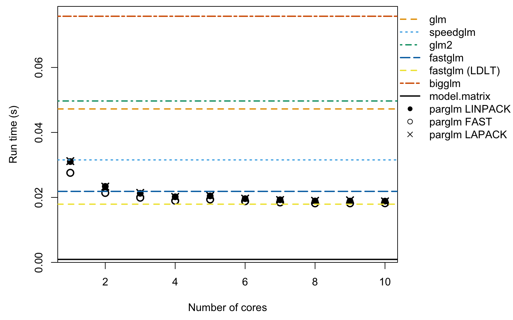
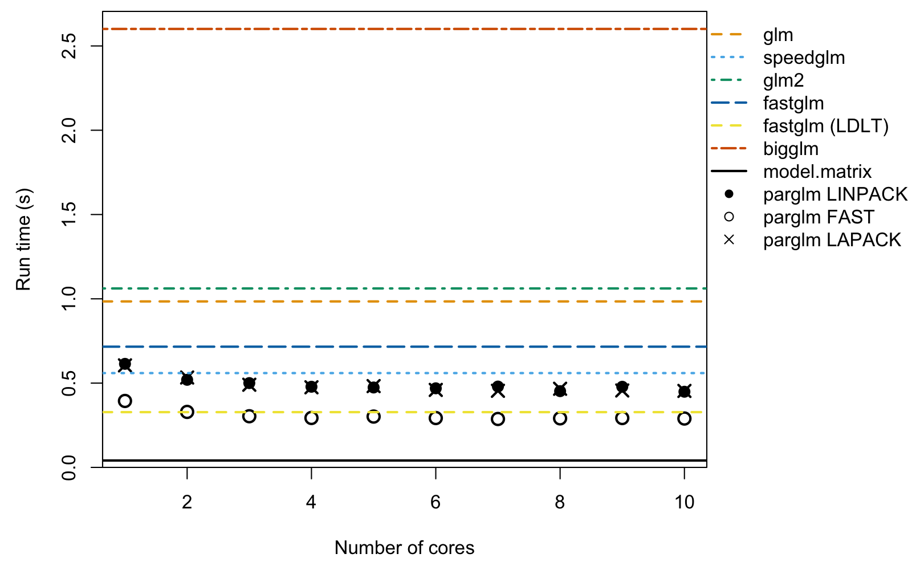

The motivation for the `parglm` package is a parallel version of the `glm`
function. It solves the iteratively re-weighted least squares using a QR
decomposition with column pivoting with the `DGEQP3` function from LAPACK.
The computation is done in parallel as in the `bam` function in the `mgcv` package. The
cost is an additional $O(Mp^2 + p^3)$ where $p$ is the number of
coefficients and $M$ is the number of chunks to be computed in parallel.
The advantage is that you do not need to compile the package with
an optimized BLAS or LAPACK which supports multithreading. The package also
includes a method that computes the Fisher information and then solves the normal
equation as in the `speedglm` package. This is faster but less numerically
stable.

## Example of computation time


Below, we estimate a logistic regression with 1000000 observations
and 50 covariates. We vary the number of cores being used with the
`nthreads` argument to `parglm.control`. The `method` argument sets which
method is used. `LINPACK` uses the same pivoted QR (`dqrdc2`) as `glm.fit`
for the final decomposition; `LAPACK` uses `DGEQP3` from LAPACK throughout;
and `FAST` solves the normal equations from the Fisher information, similar
to the `speedglm` package.


``` r
#####
# simulate
n # number of observations
#> [1] 1000000
p # number of covariates
#> [1] 50
set.seed(68024947)
X <- matrix(rnorm(n * p, 1/p, 1/sqrt(p)), n, ncol = p)
df <- data.frame(y = 1/(1 + exp(-(rowSums(X) - 1))) > runif(n), X)
```


``` r
#####
# compute and measure time. Setup call to make
library(microbenchmark)
library(speedglm)
library(fastglm)
library(glm2)
library(biglm)
library(mgcv)
library(parglm)
X_mat <- model.matrix(y ~ ., df)
biglm_form <- reformulate(names(df)[-1], response = "y")
bam_form   <- biglm_form
cl <- list(
  quote(microbenchmark),
  glm      = quote(glm     (y ~ ., binomial(), df)),
  speedglm = quote(speedglm(y ~ ., family = binomial(), data = df)),
  glm2     = quote(glm2    (y ~ ., binomial(), df)),
  fastglm  = quote(fastglm (X_mat, as.numeric(df$y), family = binomial())),
  fastglm3 = quote(fastglm (X_mat, as.numeric(df$y), family = binomial(), method = 3L)),
  bigglm   = quote(bigglm  (biglm_form, df, family = binomial())),
  bam      = quote(bam     (bam_form, family = binomial(), data = df)),
  times = 11L)
tfunc <- function(method = "LINPACK", nthreads)
  parglm(y ~ ., binomial(), df, control = parglm.control(method = method,
                                                         nthreads = nthreads))
cl <- c(
  cl, lapply(1:n_threads, function(i) bquote(tfunc(nthreads = .(i)))))
names(cl)[10:(10L + n_threads - 1L)] <- paste0("parglm-LINPACK-", 1:n_threads)

cl <- c(
  cl, lapply(1:n_threads, function(i) bquote(tfunc(
    nthreads = .(i), method = "FAST"))))
names(cl)[(10L + n_threads):(10L + 2L * n_threads - 1L)] <-
  paste0("parglm-FAST-", 1:n_threads)

cl <- c(
  cl, lapply(1:n_threads, function(i) bquote(tfunc(
    nthreads = .(i), method = "LAPACK"))))
names(cl)[(10L + 2L * n_threads):(10L + 3L * n_threads - 1L)] <-
  paste0("parglm-LAPACK-", 1:n_threads)

cl <- as.call(cl)
cl # the call we make
#> microbenchmark(glm = glm(y ~ ., binomial(), df), speedglm = speedglm(y ~ 
#>     ., family = binomial(), data = df), glm2 = glm2(y ~ ., binomial(), 
#>     df), fastglm = fastglm(X_mat, as.numeric(df$y), family = binomial()), 
#>     fastglm3 = fastglm(X_mat, as.numeric(df$y), family = binomial(), 
#>         method = 3L), bigglm = bigglm(biglm_form, df, family = binomial()), 
#>     bam = bam(bam_form, family = binomial(), data = df), times = 11L, 
#>     `parglm-LINPACK-1` = tfunc(nthreads = 1L), `parglm-LINPACK-2` = tfunc(nthreads = 2L), 
#>     `parglm-LINPACK-3` = tfunc(nthreads = 3L), `parglm-LINPACK-4` = tfunc(nthreads = 4L), 
#>     `parglm-LINPACK-5` = tfunc(nthreads = 5L), `parglm-LINPACK-6` = tfunc(nthreads = 6L), 
#>     `parglm-LINPACK-7` = tfunc(nthreads = 7L), `parglm-LINPACK-8` = tfunc(nthreads = 8L), 
#>     `parglm-LINPACK-9` = tfunc(nthreads = 9L), `parglm-LINPACK-10` = tfunc(nthreads = 10L), 
#>     `parglm-FAST-1` = tfunc(nthreads = 1L, method = "FAST"), 
#>     `parglm-FAST-2` = tfunc(nthreads = 2L, method = "FAST"), 
#>     `parglm-FAST-3` = tfunc(nthreads = 3L, method = "FAST"), 
#>     `parglm-FAST-4` = tfunc(nthreads = 4L, method = "FAST"), 
#>     `parglm-FAST-5` = tfunc(nthreads = 5L, method = "FAST"), 
#>     `parglm-FAST-6` = tfunc(nthreads = 6L, method = "FAST"), 
#>     `parglm-FAST-7` = tfunc(nthreads = 7L, method = "FAST"), 
#>     `parglm-FAST-8` = tfunc(nthreads = 8L, method = "FAST"), 
#>     `parglm-FAST-9` = tfunc(nthreads = 9L, method = "FAST"), 
#>     `parglm-FAST-10` = tfunc(nthreads = 10L, method = "FAST"), 
#>     `parglm-LAPACK-1` = tfunc(nthreads = 1L, method = "LAPACK"), 
#>     `parglm-LAPACK-2` = tfunc(nthreads = 2L, method = "LAPACK"), 
#>     `parglm-LAPACK-3` = tfunc(nthreads = 3L, method = "LAPACK"), 
#>     `parglm-LAPACK-4` = tfunc(nthreads = 4L, method = "LAPACK"), 
#>     `parglm-LAPACK-5` = tfunc(nthreads = 5L, method = "LAPACK"), 
#>     `parglm-LAPACK-6` = tfunc(nthreads = 6L, method = "LAPACK"), 
#>     `parglm-LAPACK-7` = tfunc(nthreads = 7L, method = "LAPACK"), 
#>     `parglm-LAPACK-8` = tfunc(nthreads = 8L, method = "LAPACK"), 
#>     `parglm-LAPACK-9` = tfunc(nthreads = 9L, method = "LAPACK"), 
#>     `parglm-LAPACK-10` = tfunc(nthreads = 10L, method = "LAPACK"))

out <- eval(cl)
#> Warning in microbenchmark(glm = glm(y ~ ., binomial(), df), speedglm =
#> speedglm(y ~ : less accurate nanosecond times to avoid potential integer
#> overflows
```


``` r
s <- summary(out, include_cld = FALSE) # result from `microbenchmark`
print(s[, c("expr", "min", "mean", "median", "max")], digits  = 3,
      row.names	= FALSE)
#>               expr  min mean median  max
#>                glm 2463 2535   2537 2602
#>           speedglm  774  861    808 1201
#>               glm2 2543 2583   2572 2650
#>            fastglm 2646 2699   2664 2831
#>           fastglm3  681  712    703  806
#>             bigglm 6299 6492   6561 6674
#>                bam 4480 4729   4713 5419
#>   parglm-LINPACK-1 1915 1966   1943 2047
#>   parglm-LINPACK-2 1662 1690   1678 1747
#>   parglm-LINPACK-3 1559 1597   1599 1625
#>   parglm-LINPACK-4 1559 1622   1599 1741
#>   parglm-LINPACK-5 1517 1633   1564 1895
#>   parglm-LINPACK-6 1513 1569   1562 1672
#>   parglm-LINPACK-7 1519 1547   1548 1586
#>   parglm-LINPACK-8 1487 1536   1531 1614
#>   parglm-LINPACK-9 1482 1558   1524 1816
#>  parglm-LINPACK-10 1472 1513   1519 1546
#>      parglm-FAST-1  466  502    503  544
#>      parglm-FAST-2  422  450    453  471
#>      parglm-FAST-3  394  424    419  474
#>      parglm-FAST-4  397  448    441  496
#>      parglm-FAST-5  398  434    418  580
#>      parglm-FAST-6  364  436    422  672
#>      parglm-FAST-7  376  432    414  595
#>      parglm-FAST-8  383  418    408  481
#>      parglm-FAST-9  377  414    408  477
#>     parglm-FAST-10  362  408    390  564
#>    parglm-LAPACK-1 1896 1970   1960 2052
#>    parglm-LAPACK-2 1671 1705   1696 1829
#>    parglm-LAPACK-3 1577 1625   1615 1676
#>    parglm-LAPACK-4 1551 1596   1600 1641
#>    parglm-LAPACK-5 1525 1584   1567 1668
#>    parglm-LAPACK-6 1512 1558   1543 1665
#>    parglm-LAPACK-7 1482 1530   1522 1619
#>    parglm-LAPACK-8 1487 1527   1518 1643
#>    parglm-LAPACK-9 1493 1531   1528 1602
#>   parglm-LAPACK-10 1477 1511   1499 1562
```

The plot below shows median run times versus the number of cores. Coloured
horizontal lines show the single-threaded reference times for `glm`, `speedglm`,
`glm2`, `fastglm`, `bigglm`, and `bam`. We could have used `glm.fit` and
`parglm.fit`. This would make the relative difference bigger as both call, e.g.,
`model.matrix` and `model.frame` which do take some time. To show this point, we
first compute how much time this takes and then we make the plot. The black solid
line is the computation time of `model.matrix` and `model.frame`.


``` r
modmat_time <- microbenchmark(
  modmat_time = {
    mf <- model.frame(y ~ ., df); model.matrix(terms(mf), mf)
  }, times = 10)
modmat_time # time taken by `model.matrix` and `model.frame`
#> Unit: milliseconds
#>         expr       min        lq        mean     median         uq        max
#>  modmat_time 91.896457 95.318727 127.1149486 98.2355695 122.929521 257.450562
#>  neval
#>     10
```


``` r
par(mar = c(4.5, 4.5, .5, 9))
o <- aggregate(time ~ expr, out, median)[, 2] / 10^9
ylim <- range(o, 0); ylim[2] <- ylim[2] + .04 * diff(ylim)

o_linpack <- o[8L:(n_threads + 7L)]
o_fast    <- o[(n_threads + 8L):(2L * n_threads + 7L)]
o_lapack  <- o[(2L * n_threads + 8L):(3L * n_threads + 7L)]

ref_cols <- c("#E69F00", "#56B4E9", "#009E73", "#0072B2", "#F0E442", "#D55E00", "#CC79A7")
ref_lty  <- c("dashed", "dotted", "dotdash", "longdash", "44", "twodash", "1373")

plot(1:n_threads, o_linpack, xlab = "Number of cores", yaxs = "i",
     ylim = ylim, ylab = "Run time (s)", pch = 16, cex = 1.4)
points(1:n_threads, o_fast,   pch = 1, cex = 1.4, lwd = 2)
points(1:n_threads, o_lapack, pch = 4, cex = 1.4, lwd = 2)
for (i in 1:7)
  abline(h = o[i], lty = ref_lty[i], col = ref_cols[i], lwd = 2)
abline(h = median(modmat_time$time) / 10^9, lty = "solid", col = "black",
       lwd = 2)
usr <- par("usr")
par(xpd = TRUE)
legend(x = usr[2], y = usr[4], xjust = 0, yjust = 1,
       legend = c("glm", "speedglm", "glm2", "fastglm", "fastglm (LDLT)",
                  "bigglm", "bam", "model.matrix", "parglm LINPACK",
                  "parglm FAST", "parglm LAPACK"),
       lty = c(ref_lty, "solid", NA, NA, NA),
       lwd = c(2, 2, 2, 2, 2, 2, 2, 2, NA, NA, NA),
       col = c(ref_cols, "black", "black", "black", "black"),
       pch = c(NA, NA, NA, NA, NA, NA, NA, NA, 16, 1, 4),
       bty = "n")
```

<div class="figure" style="text-align: center">

<p class="caption">Plot of runtime versus number of cores.</p>
</div>

The open circles are the `FAST` method and the filled circles are the `LINPACK`
method. The `FAST` method, `speedglm`, `fastglm`, and `fastglm` (LDLT) all
compute the Fisher information and solve the normal equation; `fastglm` (LDLT)
uses an LDLT Cholesky decomposition (method 3) rather than the default
column-pivoted QR (method 0).
This is an advantage in terms of computation cost but may lead to unstable
solutions. You can alter the number of observations in each parallel chunk
with the `block_size` argument of `parglm.control`.

The single-threaded performance of `parglm` may be slower when there are more coefficients.
The cause seems to be the difference between the LAPACK and LINPACK implementation.
This is presumably due to the QR decomposition method and/or the `qr.qty` method.
On Windows, `parglm` does seem slower when built with `Rtools` and the reason
seems to be the `qr.qty` method in LAPACK, `dormqr`, which is slower than the
LINPACK method, `dqrsl`. Below is an illustration of the
computation times on this machine.


``` r
qr1 <- qr(X)
qr2 <- qr(X, LAPACK = TRUE)
qr_times <- microbenchmark::microbenchmark(
  `qr LINPACK`     = qr(X),
  `qr LAPACK`      = qr(X, LAPACK = TRUE),
  `qr.qty LINPACK` = qr.qty(qr1, df$y),
  `qr.qty LAPACK`  = qr.qty(qr2, df$y),
  times = 11)
print(summary(qr_times, unit = "ms", include_cld = FALSE), # times in ms
      row.names = FALSE)
#>            expr        min          lq        mean     median          uq
#>      qr LINPACK 447.891667 450.4615880 459.0129766 453.984554 457.5934355
#>       qr LAPACK 390.646237 392.2255980 401.8900882 392.586275 401.0841400
#>  qr.qty LINPACK  48.409233  50.8594135 103.3221767  54.472641 112.1822115
#>   qr.qty LAPACK 111.113567 111.4466920 112.4174937 111.808640 112.8568665
#>         max neval
#>  512.239527    11
#>  467.227472    11
#>  389.662688    11
#>  115.964236    11
```

## Smaller datasets

For smaller datasets the per-call overhead of `parglm`'s thread pool can
exceed the gains from parallelism. Below we repeat the benchmark for
`n = 100,000` and `n = 10,000`, dropping `bam` since it is aimed at much
larger problems. Note the default `block_size` of `parglm.control` is
`10000`, so when `n = 10,000` the work cannot be split further across
threads and `parglm` effectively runs single-threaded regardless of
`nthreads`.


### n = 100,000


``` r
invisible(run_and_plot(n = 100000L, p = 50L, n_threads = n_threads))
#>               expr   min  mean median   max
#>                glm 172.2 174.9  173.4 178.9
#>           speedglm  64.0  68.7   64.7  99.0
#>               glm2 175.7 190.4  178.6 264.8
#>            fastglm 220.8 226.2  223.1 259.0
#>     fastglm (LDLT)  67.0  67.5   67.4  68.2
#>             bigglm 644.0 666.4  649.2 767.7
#>   parglm-LINPACK-1 151.4 153.5  152.6 160.5
#>   parglm-LINPACK-2 105.6 109.6  107.7 119.5
#>   parglm-LINPACK-3 107.2 111.0  110.7 116.9
#>   parglm-LINPACK-4  92.5  93.9   93.6  96.5
#>   parglm-LINPACK-5  91.6  93.5   93.6  94.8
#>   parglm-LINPACK-6  81.9  84.8   83.6  90.5
#>   parglm-LINPACK-7  78.4  80.1   79.6  82.8
#>   parglm-LINPACK-8  74.8  76.9   76.7  80.3
#>   parglm-LINPACK-9  70.9  79.3   71.8 134.7
#>  parglm-LINPACK-10  68.1  69.4   69.4  72.9
#>      parglm-FAST-1  40.3  43.0   41.0  52.0
#>      parglm-FAST-2  36.3  37.6   37.1  40.2
#>      parglm-FAST-3  34.5  36.5   35.0  44.2
#>      parglm-FAST-4  34.1  34.8   34.4  38.5
#>      parglm-FAST-5  33.4  34.7   33.6  42.8
#>      parglm-FAST-6  33.1  34.1   33.6  37.7
#>      parglm-FAST-7  32.5  34.5   33.4  38.1
#>      parglm-FAST-8  32.9  35.7   33.2  48.0
#>      parglm-FAST-9  32.1  32.9   32.7  34.4
#>     parglm-FAST-10  32.0  32.9   32.5  35.9
#>    parglm-LAPACK-1 151.2 152.2  152.2 153.4
#>    parglm-LAPACK-2 105.8 109.6  108.7 116.0
#>    parglm-LAPACK-3 105.0 109.3  109.3 112.0
#>    parglm-LAPACK-4  93.5  95.5   94.9 102.1
#>    parglm-LAPACK-5  90.6  94.3   93.3 104.7
#>    parglm-LAPACK-6  81.8  83.1   82.9  84.8
#>    parglm-LAPACK-7  77.9  79.4   78.4  82.6
#>    parglm-LAPACK-8  74.7  77.9   76.3  89.6
#>    parglm-LAPACK-9  69.7  71.9   70.7  79.5
#>   parglm-LAPACK-10  67.3  70.7   68.6  85.2
```

<div class="figure" style="text-align: center">

<p class="caption">Plot of runtime versus number of cores for n = 100,000.</p>
</div>

### n = 10,000


``` r
invisible(run_and_plot(n = 10000L, p = 50L, n_threads = n_threads))
#>               expr   min  mean median   max
#>                glm 14.77 15.35  15.36 15.84
#>           speedglm  7.64  7.89   7.84  8.33
#>               glm2 14.26 15.76  15.86 16.50
#>            fastglm 19.98 20.56  20.59 20.91
#>     fastglm (LDLT)  6.54  6.73   6.78  6.91
#>             bigglm 53.45 55.57  54.18 63.11
#>   parglm-LINPACK-1 11.29 12.19  11.47 19.42
#>   parglm-LINPACK-2  8.77  9.02   8.96  9.41
#>   parglm-LINPACK-3  8.42  8.54   8.50  8.73
#>   parglm-LINPACK-4  8.07  8.20   8.14  8.42
#>   parglm-LINPACK-5  7.41  7.61   7.56  8.15
#>   parglm-LINPACK-6  7.90  8.10   8.16  8.28
#>   parglm-LINPACK-7  7.69  7.89   7.87  8.08
#>   parglm-LINPACK-8  7.82  8.01   7.99  8.19
#>   parglm-LINPACK-9  7.98  8.17   8.19  8.37
#>  parglm-LINPACK-10  8.06  8.28   8.32  8.45
#>      parglm-FAST-1  4.70  4.91   4.79  5.26
#>      parglm-FAST-2  4.20  4.41   4.38  4.59
#>      parglm-FAST-3  4.18  4.29   4.31  4.41
#>      parglm-FAST-4  4.11  4.34   4.30  4.55
#>      parglm-FAST-5  4.34  4.45   4.44  4.57
#>      parglm-FAST-6  4.37  4.52   4.43  5.37
#>      parglm-FAST-7  4.27  4.41   4.39  4.59
#>      parglm-FAST-8  4.28  4.49   4.49  4.69
#>      parglm-FAST-9  4.39  4.59   4.56  5.13
#>     parglm-FAST-10  4.35  4.47   4.49  4.59
#>    parglm-LAPACK-1 11.27 11.47  11.44 11.66
#>    parglm-LAPACK-2  8.86  9.11   9.11  9.35
#>    parglm-LAPACK-3  8.47 11.37   8.61 38.99
#>    parglm-LAPACK-4  8.01  8.26   8.26  8.59
#>    parglm-LAPACK-5  7.57  7.89   7.71  9.90
#>    parglm-LAPACK-6  7.70  7.93   7.85  8.33
#>    parglm-LAPACK-7  7.32  7.54   7.49  7.83
#>    parglm-LAPACK-8  7.39  7.57   7.58  7.81
#>    parglm-LAPACK-9  7.29  7.45   7.42  7.79
#>   parglm-LAPACK-10  7.31  7.48   7.42  7.80
```

<div class="figure" style="text-align: center">

<p class="caption">Plot of runtime versus number of cores for n = 10,000.</p>
</div>

## Varying the number of coefficients

The per-row cost of each method scales roughly with $p^2$ (computing
$X'WX$ at each IRLS iteration), while parglm's thread-pool overhead is
roughly fixed per call. The two effects compete: with small $p$ the
overhead dominates the parallel benefit, while with larger $p$ the
parallel work amortizes the overhead and parglm pulls ahead. Below we
contrast `n = 100,000, p = 5` (where the overhead wins) with
`n = 1,000,000, p = 20` (where the parallel work wins).

### n = 100,000, p = 5


``` r
invisible(run_and_plot(n = 100000L, p = 5L, n_threads = n_threads))
#>               expr  min mean median  max
#>                glm 40.5 41.5   41.1 46.2
#>           speedglm 29.4 30.7   29.9 34.7
#>               glm2 42.2 42.9   42.6 44.9
#>            fastglm 23.1 23.5   23.5 23.8
#>     fastglm (LDLT) 18.7 19.1   19.0 19.5
#>             bigglm 77.6 79.1   78.7 82.2
#>   parglm-LINPACK-1 26.0 26.5   26.4 27.5
#>   parglm-LINPACK-2 21.3 21.9   21.7 23.7
#>   parglm-LINPACK-3 19.9 20.9   20.3 24.0
#>   parglm-LINPACK-4 19.2 19.7   19.5 21.4
#>   parglm-LINPACK-5 19.6 20.1   19.9 21.9
#>   parglm-LINPACK-6 19.2 19.5   19.4 20.1
#>   parglm-LINPACK-7 18.8 19.3   19.2 19.5
#>   parglm-LINPACK-8 18.6 20.0   19.1 29.2
#>   parglm-LINPACK-9 18.7 19.7   19.3 22.7
#>  parglm-LINPACK-10 18.8 19.2   19.1 21.1
#>      parglm-FAST-1 24.6 25.3   25.1 27.8
#>      parglm-FAST-2 20.4 21.2   20.9 24.4
#>      parglm-FAST-3 19.3 19.8   19.7 21.5
#>      parglm-FAST-4 18.7 18.9   18.9 19.3
#>      parglm-FAST-5 19.1 19.4   19.3 20.1
#>      parglm-FAST-6 18.6 19.1   18.9 20.9
#>      parglm-FAST-7 18.2 18.8   18.8 19.2
#>      parglm-FAST-8 18.0 19.1   18.5 23.0
#>      parglm-FAST-9 18.4 18.9   18.7 20.2
#>     parglm-FAST-10 18.3 18.5   18.5 18.9
#>    parglm-LAPACK-1 26.1 26.5   26.4 27.4
#>    parglm-LAPACK-2 21.5 22.1   21.8 25.1
#>    parglm-LAPACK-3 19.6 20.2   20.2 20.5
#>    parglm-LAPACK-4 19.2 19.6   19.6 19.9
#>    parglm-LAPACK-5 19.6 20.2   19.9 22.1
#>    parglm-LAPACK-6 19.2 19.7   19.7 21.1
#>    parglm-LAPACK-7 18.8 19.2   19.3 19.7
#>    parglm-LAPACK-8 18.6 19.3   19.0 21.1
#>    parglm-LAPACK-9 18.8 19.3   19.3 19.7
#>   parglm-LAPACK-10 18.8 19.1   19.1 19.5
```

<div class="figure" style="text-align: center">

<p class="caption">Plot of runtime versus number of cores for n = 100,000 and p = 5.</p>
</div>

### n = 1,000,000, p = 20


``` r
invisible(run_and_plot(n = 1000000L, p = 20L, n_threads = n_threads))
#>               expr  min mean median  max
#>                glm  954  982    985 1014
#>           speedglm  520  563    560  620
#>               glm2  988 1058   1062 1122
#>            fastglm  705  733    716  845
#>     fastglm (LDLT)  307  341    328  445
#>             bigglm 2535 2600   2601 2708
#>   parglm-LINPACK-1  587  625    614  727
#>   parglm-LINPACK-2  508  532    520  622
#>   parglm-LINPACK-3  483  513    500  644
#>   parglm-LINPACK-4  465  486    478  534
#>   parglm-LINPACK-5  459  479    474  529
#>   parglm-LINPACK-6  450  474    469  557
#>   parglm-LINPACK-7  455  489    480  532
#>   parglm-LINPACK-8  443  468    452  538
#>   parglm-LINPACK-9  438  480    478  536
#>  parglm-LINPACK-10  428  449    449  471
#>      parglm-FAST-1  378  392    394  417
#>      parglm-FAST-2  317  337    329  377
#>      parglm-FAST-3  290  316    303  387
#>      parglm-FAST-4  279  305    293  421
#>      parglm-FAST-5  281  302    301  321
#>      parglm-FAST-6  277  298    293  363
#>      parglm-FAST-7  271  299    287  392
#>      parglm-FAST-8  271  301    291  364
#>      parglm-FAST-9  273  302    293  378
#>     parglm-FAST-10  271  310    290  377
#>    parglm-LAPACK-1  583  615    605  660
#>    parglm-LAPACK-2  513  533    533  579
#>    parglm-LAPACK-3  477  500    490  533
#>    parglm-LAPACK-4  468  494    475  647
#>    parglm-LAPACK-5  459  491    482  591
#>    parglm-LAPACK-6  451  474    460  574
#>    parglm-LAPACK-7  446  455    454  468
#>    parglm-LAPACK-8  443  476    466  599
#>    parglm-LAPACK-9  431  463    456  541
#>   parglm-LAPACK-10  424  460    454  563
```

<div class="figure" style="text-align: center">

<p class="caption">Plot of runtime versus number of cores for n = 1,000,000 and p = 20.</p>
</div>

## Session info


``` r
sessionInfo()
#> R version 4.6.2 (2026-10-29)
#> Platform: aarch64-apple-darwin23
#> Running under: macOS Golden Gate 27.2.1
#> 
#> Matrix products: default
#> BLAS:   /System/Library/Frameworks/Accelerate.framework/Versions/A/Frameworks/vecLib.framework/Versions/A/libBLAS.dylib 
#> LAPACK: /Library/Frameworks/R.framework/Versions/4.6/Resources/lib/libRlapack.dylib;  LAPACK version 3.12.1
#> 
#> locale:
#> [1] C.UTF-8/C.UTF-8/C.UTF-8/C/C.UTF-8/C.UTF-8
#> 
#> time zone: Europe/London
#> tzcode source: internal
#> 
#> attached base packages:
#> [1] stats     graphics  grDevices utils     datasets  methods   base     
#> 
#> other attached packages:
#>  [1] parglm_0.2.1         mgcv_1.9-5           nlme_3.1-172        
#>  [4] glm2_1.2.1           fastglm_0.1.4        speedglm_0.3-5      
#>  [7] biglm_0.9-3          DBI_1.3.0            MASS_7.3-66         
#> [10] Matrix_1.7-6         microbenchmark_1.5.0
#> 
#> loaded via a namespace (and not attached):
#>  [1] cli_3.6.6           knitr_1.52          TH.data_1.1-5      
#>  [4] rlang_1.3.0         xfun_0.62           otel_0.3.0         
#>  [7] zoo_1.9-1           bigmemory_4.6.6     grid_4.6.2         
#> [10] evaluate_1.0.5      mvtnorm_1.4-2       bigmemory.sri_0.1.8
#> [13] multcomp_1.4-32     compiler_4.6.2      codetools_0.2-20   
#> [16] sandwich_3.1-3      Rcpp_1.1.2          lattice_0.23-1     
#> [19] digest_0.6.39       parallel_4.6.2      splines_4.6.2      
#> [22] uuid_1.2-2          tools_4.6.2         survival_3.8-12
```
